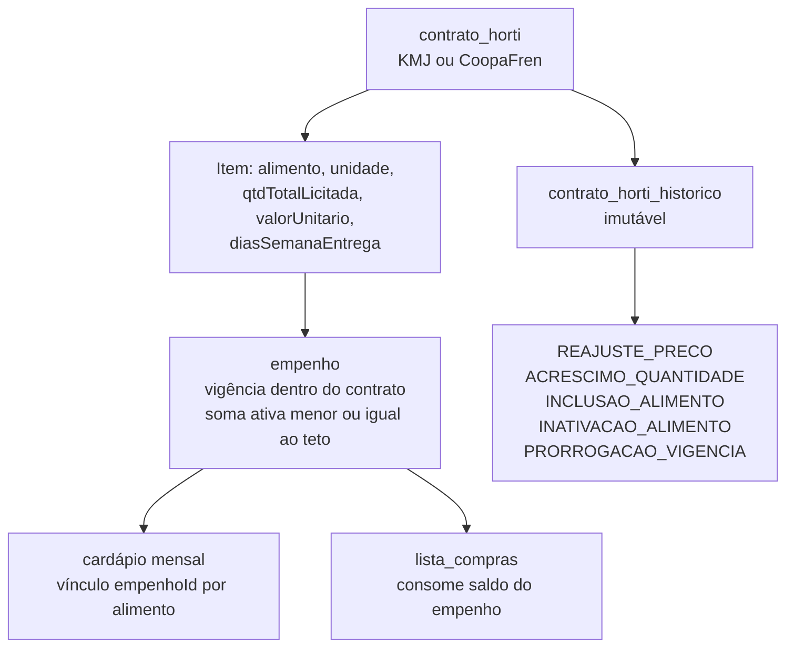
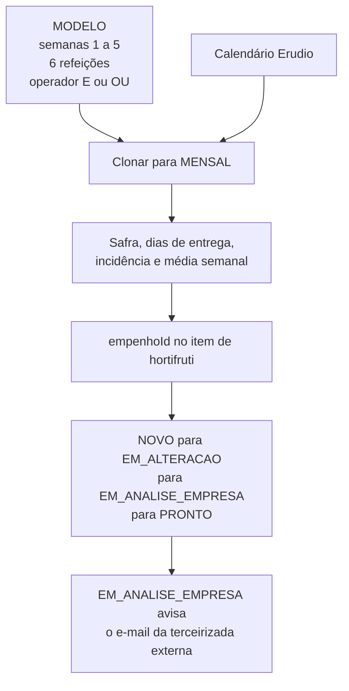

# Arquitetura e fluxos — Alimentação Escolar (PNAE / SME Itajaí)

Documento mestre do workspace `sistema-nutri`. Nomes de campos, enums e travas abaixo são a referência para módulos, DTOs, endpoints e telas.

## Divisão de sistemas

| Sistema | Papel | Identificadores |
| --- | --- | --- |
| Erudio | Fonte da verdade de escola, etapa, turno, matrícula, usuário e calendário letivo. Contrato e mock em `docs/INTEGRACAO_ERUDIO_MOCKS.md` | `erudioUnidadeEnsinoId`, `erudioEtapaId`, `erudioTurnoId`, `erudioMatriculaId`, `erudioUsuarioId` (sempre numéricos) |
| Sistema Nutri | Back-end NestJS + Mongoose/MongoDB e front-end Nuxt/Vue + Tailwind. Cardápio, alimento, ficha, contrato de hortifruti, empenho e, no desenho previsto, lista de compras e execução diária | `ObjectId` do Mongo nas entidades próprias |

O Nutri não replica cadastro escolar. Guarda só o ID numérico do Erudio e consulta alunos ativos, feriados e reuniões pedagógicas na hora do fluxo. A forma real dessas consultas (IDs, nomes e o que o adapter traduz) está em `docs/INTEGRACAO_ERUDIO_MOCKS.md`. `demandas_escolares` continua sendo o snapshot local que o motor da lista lê hoje; não é o contrato do legado.

O contrato de prestação de serviço (terceirizada) **não é collection deste banco**. Ele já existe em outro sistema. Aqui ele aparece apenas como referência externa (`contratoTerceirizadaId` nulo significa regra da `LEI_PNAE`) e como valor usado na meta de 45% de agricultura familiar. Fornecedores do `contrato_horti` neste sistema: KMJ e CoopaFren. A Cooperar é a empresa da prestação de serviço externa.

## Estado da implementação

| Collection | Situação |
| --- | --- |
| `alimentos`, `grupos_incidencia`, `referencias_nutricionais_pnae` | Módulo `alimentos` |
| `contratos_horti`, `contratos_horti_historico` | Módulo `contratos-horti`. Rotas em `/contratos-horti` |
| `empenhos` | Módulo `empenhos`. Rotas em `/empenhos` |
| `fichas_tecnicas` | Módulo `fichas-tecnicas`. Rotas em `/fichas-tecnicas` |
| `cardapios` e subdocumentos de dia/refeição, `agrupamentos_cardapio` | Módulo `cardapios`. Rotas em `/cardapios` e `/agrupamentos-cardapio` |
| `contrato_terceirizada` | Outro banco. Não criar módulo local |
| `listas_compras`, leitura de `cardapios`, `fichas_tecnicas`, `alimentacoes_especiais` e `demandas_escolares` | Módulo `listas-compras`. `POST /listas-compras/simular` e `POST /listas-compras/gerar` |
| `execucoes_refeicao_dia` | Modelo previsto. Sem módulo até o fluxo correspondente ser pedido |
| `incidencias_regra` | CRUD em `/incidencias-regras` e validação `POST /cardapios/:id/validar-incidencias`. Grupos continuam em `/grupos-incidencia` |

No back-end o saldo de novo empenho é `qtdTotalLicitada − soma dos empenhos ativos`. O consumo real é a soma das `listas_compras` `CONFIRMADA`/`GERADA` vinculadas ao `empenhoId` (detalhe em `docs/FLUXO_LISTA_COMPRAS.md`), e não um campo gravado no empenho. No protótipo, `qtdConsumida` abre a barra e cada pedido gerado em `/listas-compras` abate de novo esse saldo.

## Fluxo 1 — Contratos de hortifruti e empenhos

O empenho é a ponte financeira: nasce do `contrato_horti`, reserva quantidade para o cardápio do mês e, depois, é abatido pela lista de compras.

Travas do `EmpenhosService`:

- `dataInicio` e `dataFim` do empenho ficam dentro de `vigenciaInicio` e `vigenciaFim` do contrato, e `dataFim` não é anterior a `dataInicio`.
- Só alimento ativo em `contrato_horti.itens`, com a mesma `unidadeMedida`.
- A soma de `qtdEmpenhada` dos empenhos ativos daquele alimento, no mesmo contrato, não ultrapassa `qtdTotalLicitada`. Igual ao teto é permitido.
- Empenho inativo não entra na soma. Na edição, o próprio documento é excluído da soma antes de somar a quantidade nova.
- Número do empenho é único por `contratoHortiId`.
- Itens do contrato só mudam por `PUT /contratos-horti/:id/itens` (substituição direta, usada pela tela) ou `POST /contratos-horti/:id/itens/alteracoes` (evento auditado no `contratos_horti_historico`). O histórico recusa update e delete.
- `gramasPorUnidade` é obrigatório (> 0) quando `unidadeMedida` é `UNIDADE`, `MACO` ou `DUZIA`; para `LITRO` sem o campo, o sistema assume 1000 g/unidade. `KG`/`GRAMA` não usam o campo.
- Item de contrato **com empenho ativo** não pode alterar `unidadeMedida` nem `gramasPorUnidade` (trava em inclusão/inativação via alteração de item).
- `GET /contratos-horti/:id` devolve o contrato com `qtdEmpenhada` e `saldoDisponivel` (`qtdTotalLicitada − empenhado`) calculados por item a partir dos empenhos ativos.

Saldo físico e financeiro, por alimento do empenho:

- Empenhado: `qtdEmpenhada` e `qtdEmpenhada × valorUnitario`.
- Consumido: quantidade das `listas_compras` daquele `empenhoId` e alimento. No protótipo, `qtdConsumida` do mock.
- Disponível no empenho: empenhado − consumido.
- Disponível para novo empenho: `qtdTotalLicitada − soma empenhada ativa`.

## Fluxo 2 — Cardápio unificado

`cardapio.tipo` é `MODELO` (fixo, reutilizável) ou `MENSAL` (mês/ano de uma etapa). Os dois usam a mesma estrutura.

**Dependência obrigatória:** o cardápio mensal só pode ser criado a partir de um cardápio `MODELO` da **mesma etapa** (`agrupamentoCardapioId`) e **mesmo ano** (`ano`). O modelo é quem define a estrutura do cardápio — número de semanas, dias da grade e, principalmente, **quais refeições existem** (`refeicoes`) e os itens-base. Sem modelo cadastrado para a etapa/ano, o fluxo de clonagem é bloqueado na interface ("Nenhum cardápio modelo cadastrado para esta etapa").

Regras do cardápio:

- Dia: `numeroSemana` 1..5, `diaSemana` 1..5 (segunda a sexta), `tipoDia` `LETIVO`, `FERIADO`, `REUNIAO_PEDAGOGICA` ou `RECESSO`.
- Refeições: lanche da manhã 1, lanche da manhã 2, almoço, lanche da tarde, jantar e ceia.
- Itens da refeição usam operador `E` (soma) ou `OU` (média das alternativas). O primeiro item não tem operador.
- Hortifruti do cardápio só entra se estiver ativo em algum `contrato_horti` — **bloqueio no back-end** (`POST /cardapios/:id/dias/.../itens` retorna 400).
- Item de hortifruti (`origem: ALIMENTO`) exige `empenhoId` de empenho **ativo** que contenha o alimento com saldo (`qtdEmpenhada − soma das listas_compras GERADA do empenho > 0`) — **bloqueio no back-end**. Para `origem: FICHA`, cada vínculo de `empenhosIngredientes` é validado da mesma forma quando informado.
- **Safra** (`alimento.safraMensal`): gera apenas **aviso** na interface, nunca bloqueia. No cardápio, item `ALIMENTO` mostra badge "Fora de safra"/"Média produção" conforme o mês de referência (`dia.data` → `cardapio.mes` → mês atual); item `FICHA` herda o pior status entre os ingredientes. Também aparece no banner "Safra do mês" e no modal de inclusão.
- **Dias de entrega** (`itemContrato.diasSemanaEntrega`): controle interno do contrato, sem aviso no cardápio — não bloqueia nem sinaliza o nutricionista.
- A média semanal considera apenas dias `LETIVO` e compara com `referencias_nutricionais_pnae` da etapa. Retinol do alimento corresponde à vitamina A da referência.
- Status operacional do mensal: `NOVO`, `EM_ALTERACAO`, `EM_ANALISE_EMPRESA`, `PRONTO`. `EM_ANALISE_EMPRESA` dispara o e-mail de `contrato_terceirizada.emailNotificacao` no outro sistema.
- Cada alimento de hortifruti do mês aponta para um `empenhoId` ativo que ainda tenha saldo.

## Fluxo 3 — Lista de compras (romaneio de hortifruti)

Implementado em `ListasComprasService`. O pipeline completo (escopo por datas/escolas/etapas, explosão de fichas, alimentação especial, rateio sugerido entre empenhos e ciclo de vida da lista) está detalhado em `docs/FLUXO_LISTA_COMPRAS.md`. Resumo:

1. `POST /listas-compras/simular` calcula sem gravar; `POST /listas-compras/gerar` grava `CONFIRMADA` (ou `RASCUNHO` com `rascunho: true`).
2. `contratoHortiId` é **opcional**: sem ele, itens de todos os contratos ativos são candidatos e o empenho alocado define o contrato de cada alimento; a lista grava `contratoHortiIds[]` com os contratos tocados.
3. Somente listas `CONFIRMADA` (e `GERADA` legada) abatem o saldo dos empenhos; `RASCUNHO` e `CANCELADA` não. `PATCH /:id/confirmar` revalida o saldo; `PATCH /:id/cancelar` libera.
4. Sem rateio manual, o motor sugere a divisão entre empenhos ordenando por `dataFim` (vence primeiro) e sinaliza `RATEIO_INSUFICIENTE` com `saldoTotalDisponivel` quando o saldo total não cobre.
5. `GET /empenhos/saldo-concorrente` (todos os contratos) e `GET /empenhos/saldo-concorrente/:contratoHortiId` expõem `qtdEmpenhada`, `qtdAlocada` e `saldoDisponivel` por alimento/empenho.

## Fluxo 4 — Auditoria diária na escola

Previsto na collection `execucoes_refeicao_dia`. A escola marca o dia `CUMPRIDO` ou `NAO_CUMPRIDO`. `NAO_CUMPRIDO` exige observação. Os dois gravam autor (`erudioUsuarioId`) e timestamp. Status inicial: `NAO_AVALIADO`.

## Dicionário de entidades

Enums usados nos campos:

- `CategoriaAlimento`: `FRUTA`, `LEGUME`, `VERDURA`, `CEREAL_GRAO`, `PROTEINA`, `LATICINIO`, `OUTROS`
- `UnidadeMedida`: `KG`, `DUZIA`, `MACO`, `UNIDADE`, `LITRO`, `GRAMA`
- `StatusSafra`: `SAFRA_PLENA`, `MEDIA_PRODUCAO`, `FORA_SAFRA`
- `NivelRestricaoFnde`: `PERMITIDO`, `OFERTA_LIMITADA`, `PROIBIDO`
- `OrigemRegraIncidencia`: `LEI_PNAE`, `CONTRATO_TERCEIRIZADA`
- `PeriodoIncidencia`: `SEMANAL`, `MENSAL`
- `TipoEventoContrato`: `CONTRATO_INICIAL`, `INCLUSAO_ALIMENTO`, `REAJUSTE_PRECO`, `ACRESCIMO_QUANTIDADE`, `INATIVACAO_ALIMENTO`, `PRORROGACAO_VIGENCIA`
- `TipoCardapio`: `MODELO`, `MENSAL`
- `StatusCardapio`: `ATIVO`, `INATIVO`, `NOVO`, `EM_ALTERACAO`, `EM_ANALISE_EMPRESA`, `PRONTO`
- `TipoDiaCardapio`: `LETIVO`, `FERIADO`, `REUNIAO_PEDAGOGICA`, `RECESSO`
- `OperadorItemRefeicao`: `E`, `OU`
- `StatusExecucaoDia`: `NAO_AVALIADO`, `CUMPRIDO`, `NAO_CUMPRIDO`
- `StatusAlimentacaoEspecial`: `EM_ANALISE`, `DEFERIDO`, `INDEFERIDO`, `ENCERRADO`

### `alimentos`

Lista plana. Não existe `alimentoPaiId`.

- `nome`, `categoria`, `unidadeMedidaPadrao`, `gruposIncidenciaIds`, `ativo`
- `composicaoNutricional` por 100 g: `kcal`, `proteina`, `lipidios`, `carboidratos`, `fibraAlimentar`, `calcio`, `ferro`, `retinol`, `vitaminaC`, `sodio`, `zinco`, `magnesio`
- `safraMensal`: `{ mes: 1..12, status }`
- `restricoesEtapaFnde`: `{ erudioEtapaId, nivel, observacao? }`

### `grupos_incidencia`

`nome`, `origemRegra` (`LEI_PNAE` ou `CONTRATO_TERCEIRIZADA`), `ativo`.

### `agrupamentos_cardapio`

Agrupa etapas do Erudio que compartilham o mesmo cardápio. É a chave obrigatória de cardápio, regra de incidência e meta PNAE. Campos: `nome`, `sigla`, `erudioEtapaIds: number[]`, `ativo`.

### `contratos_horti`

Compra e entrega física. Campos obrigatórios, sem ramo de terceirizada.

- `numeroContrato`, `fornecedorNome`, `fornecedorCnpj`, `agriculturaFamiliar`
- `vigenciaInicio`, `vigenciaFim`, `arredondamentoTotalAlimentos`, `ativo`
- `itens[]`: `alimentoId`, `unidadeMedida`, `qtdTotalLicitada`, `valorUnitario`, `perCapita`, `fatorCorrecao`, `gramasPorUnidade` (obrigatório para `UNIDADE`/`MACO`/`DUZIA`; `LITRO` assume 1000 g quando nulo), `diasSemanaEntrega` (0..6, únicos), `ativo`

Rotas: `POST /contratos-horti` (cria), `GET /contratos-horti` (filtros `fornecedorNome`, `numeroContrato`, `vigenteEm`, `ativo`, `agriculturaFamiliar`), `GET /:id` (com saldos de empenho por item), `PATCH /:id` (dados gerais, sem itens), `DELETE /:id`, `GET /:id/historico`, `PUT /:id/itens`, `POST /:id/itens/alteracoes`.

`agriculturaFamiliar: true` entra na meta legal de 45% do PNAE. O denominador da meta também inclui o valor da prestação de serviço que vive no outro sistema.

### `contratos_horti_historico`

Log imutável. `contratoHortiId`, `tipoEvento`, `numeroDocumento`, `dataVigencia`, `alimentoId`, `unidadeMedida`, `valorAnterior`, `valorNovo`, `qtdAnterior`, `qtdNova`, `motivo`, `autorUsuarioId`, `createdAt`.

### `contrato_terceirizada` (outro banco)

Não persistir aqui. Forma esperada na integração: `numeroContrato`, `empresaNome`, `empresaCnpj`, `emailNotificacao`, `vigenciaInicio`, `vigenciaFim`, `itensOfertados[]` com `alimentoId`, `itemDoCardapio`, `ativo`. O e-mail recebe o cardápio quando o status vai para `EM_ANALISE_EMPRESA`.

### `empenhos`

Somente `contratoHortiId`.

- `numeroEmpenho`, `fonteRecurso`, `dataInicio`, `dataFim`, `ativo`
- `itensEmpenhados[]`: `alimentoId`, `qtdEmpenhada`, `unidadeMedida`, `valorUnitario`, `previsaoMensal[]` de `{ mes, ano, qtdPrevista }`

Endpoints de leitura para cardápio e lista:

- `GET /empenhos/saldo-disponivel/:contratoHortiId` — teto, já empenhado e restante de cada item ativo.
- `GET /empenhos/ativos-por-alimento/:alimentoId` — empenhos ativos que reservam aquele alimento, para o seletor de `empenhoId`.
- `GET /empenhos/saldo-concorrente[/:contratoHortiId]` — saldo concorrente por alimento/empenho (`qtdEmpenhada − qtdAlocada` em listas confirmadas); sem id agrega todos os contratos ativos.

### `incidencias_regra`

`contratoTerceirizadaId` nulo aplica a Lei do PNAE; preenchido, vincula ao contrato da terceirizada (o contrato não é coleção deste banco). `tipoAlvo` (`GRUPO`, `FICHA_TECNICA` ou `ALIMENTO`) com o identificador correspondente. `agrupamentoCardapioId` obrigatório. `periodo` (`SEMANAL` ou `MENSAL`), `frequenciaMinima`, `frequenciaMaxima` (`0` proíbe o alvo naquela etapa) e `ativo`. O grupo guarda `nome`, `categoriaVisual` (coluna da planilha: PROTEINA, AMIDO, BEBIDAS…), `origemRegra` e `ativo`. Ficha técnica: `gruposIncidenciaIds[]` para tag de receita inteira.

### `fichas_tecnicas`

`nome`, `modoPreparo`, `rendimentoTotalGramas`, `fatorCoccao`, `ingredientes[]` (`alimentoId`, `perCapitaBruto`, `perCapitaLiquido`; fator de correção = bruto ÷ líquido), `porcoesEtapa[]` (`erudioEtapaId`, `quantidadeGramas`). Na explosão da lista, grupo `OU` só compra ingrediente com `ativoParaCompra: true`.

### `referencias_nutricionais_pnae`

Faixa por agrupamento de cardápio: mínimos e máximos de energia, proteína, lipídios, carboidratos, cálcio, ferro, vitamina A, vitamina C e sódio. A comparação semanal usa a média dos dias letivos.

### `cardapios`, `cardapio_dia`, `cardapio_refeicao`

- Cardápio: `tipo`, `status`, `nome`, `agrupamentoCardapioId` (padrão único — `erudioEtapaId` é apenas o primeiro `erudioEtapaIds` do agrupamento, mantido para leitura legada), e no mensal `mes` e `ano`.
- Dia: `numeroSemana`, `diaSemana` (1..5 = segunda a sexta, grade do cardápio), `tipoDia`, `refeicoes[]`. No cardápio `MENSAL`, cada dia recebe `data` real do calendário (semana 1 = semana de segunda a domingo que contém o dia 1 do mês); dias cuja data cai em outro mês aparecem travados como "Fora do mês" na grade. Atenção: `contrato_horti.itens[].diasSemanaEntrega` usa 0..6 no padrão `Date.getDay()` (0 = domingo a 6 = sábado); para segunda a sexta os números coincidem com `diaSemana` (1..5), mas 0 e 6 nunca aparecem na grade.
- Item da refeição: `operador` (`E` ou `OU`), referência a ficha ou a alimento de hortifruti, `perCapita`, e no mensal `empenhoId` quando o item é hortifruti.

### `execucoes_refeicao_dia` (previsto)

`cardapioId`, `data`, `erudioUnidadeEnsinoId`, `refeicao`, `status`, `observacao` obrigatória se `NAO_CUMPRIDO`, `erudioUsuarioId`, `avaliadoEm`.

### `alimentacoes_especiais` (leitura no motor da lista)

`erudioMatriculaId`, `erudioUnidadeEnsinoId`, `erudioEtapaId`, `status`, `alimentosNaoUtilizadosIds` e `alimentosUtilizadosIds` da mesma `CategoriaAlimento`. Só `DEFERIDO` altera a lista de compras.

### `listas_compras`

`contratoHortiId` (opcional, retrocompat) + `contratoHortiIds[]` (contratos dos empenhos alocados), `datasConsumo`, `erudioEtapaIds`/`erudioUnidadeEnsinoIds` (escopo do cálculo), `status` (`RASCUNHO`, `CONFIRMADA`, `CANCELADA`, `GERADA` legado), dias considerados e ignorados, `consolidado`, `romaneio` por `erudioUnidadeEnsinoId` com `substituicoesAplicadas`, `alocacoes` (rateios por alimento) e `itensPendentes`. Detalhes em `docs/FLUXO_LISTA_COMPRAS.md`.

### `demandas_escolares` (leitura)

`erudioUnidadeEnsinoId`, `erudioEtapaId`, `nomeEscola`, `alunosAtivos`. O `ErudioAdapterService` lê essa collection para multiplicar o per capita.

## Front-end

O front-end Nuxt/Vue (`/front-end`) consome a API real via `app/composables/useNutricao.ts` (estado global com `useState`) e `useErudioMock.ts` (dados escolares do Erudio). `src/mocks/` concentra tipos e helpers de exibição; a lógica de cálculo replica o motor do back-end apenas para referência.

Telas:

- **Contratos de hortifruti** (`/contratos`): lista lateral + detalhe. Cria contrato (`POST`), edita dados gerais (`PATCH`), substitui itens (`PUT /:id/itens`, com coluna `g/unid.` para `gramasPorUnidade`), visualiza empenhado/disponível por item (`GET /:id` já traz os saldos) e registra alterações auditadas (`POST /:id/itens/alteracoes` + histórico).
- **Empenhos** (`/empenhos`): cadastro por contrato com previsão mensal e saldo disponível para empenhar.
- **Lista de compras** (`/listas-compras`): período + escopo (etapas/escolas), rateio sugerido editável por empenho, saldo concorrente inline, salvar rascunho / gerar confirmada, e histórico com confirmar/cancelar. Detalhes em `docs/FLUXO_LISTA_COMPRAS.md`.
- Demais telas: visão geral, alimentos, fichas técnicas, cardápios, alimentação especial, referências PNAE e regras de incidência/refeição.
